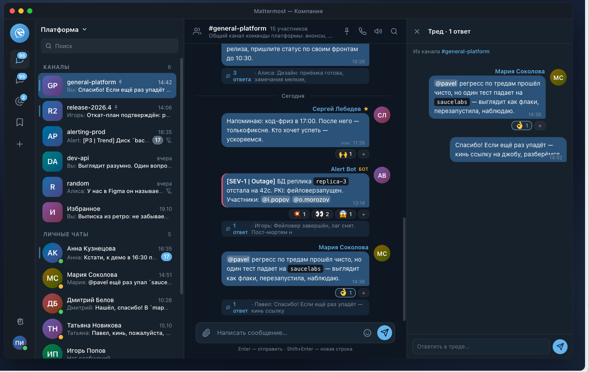

# MatterDock

Нативный macOS-клиент Mattermost: пузыри как в Telegram, без Electron и WebView.
Форк [MatterMac](https://github.com/dfrnoch/MatterMac) (MIT), отвязанный от
upstream: развитие, сборка и распространение — самостоятельные. Подробности
форка, изменённое и причины — в [FORK.md](FORK.md).



*Концепт интерфейса; клиент воспроизводит его 1:1 (ADR 0042): пузыри, тред-панель,
крупный список чатов с превью, полоса серьёзности у алертов.*

Последний релиз: **[v0.10.1](https://github.com/ipashab/MatterDock/releases/tag/v0.10.1)**
(DMG и ZIP, universal arm64 + x86_64).

## Почему MatterDock

- **Telegram-style таймлайн.** Пузыри с хвостом у нижнего угла, своё справа /
  чужое слева, аватары и имя автора, meta-пилюля со временем в углу пузыря,
  полоса серьёзности (warn/danger/ok) у `[SEV-*]`-алертов, чип треда с превью
  последнего ответа. Flat-режим — одной настройкой.
- **Нативный, не браузер.** Swift 6 + SwiftUI/AppKit, ноль внешних зависимостей
  в рантайме, ~12 МБ приложение, universal-бинарь (Apple Silicon + Intel),
  macOS 14+. Никаких Electron, WKWebView и фоновых серверов.
- **Приватность по дизайну.** Токен только в Keychain и в заголовке Authorization;
  эфемерные URLSession без cookie-кеша; кеш картинок AES-GCM-шифруется ключом
  аккаунта; тело сообщений не пишется ни в логи, ни на диск.
- **Треды как в веб-клиенте (CRT).** Свёрнутые по умолчанию, ответы — боковой
  панелью; реакции, упоминания, поиск, закрепление — как принято в Mattermost.
- **Крупный список чатов.** Аватары, время и превью последнего сообщения —
  обновляется вживую; выключается тумблером обратно в компактный.
- **Русский интерфейс** (выбор языка в Настройках ▸ Основные) и аккуратная
  светлая/тёмная темы, включая мягкую палитру пузырей для светлой.
- **Любой Mattermost-сервер** — не привязан к деплою; ESR 10.x и 11.x, серверы
  с zstd-кешем nginx за avatar/img-эндпоинтами поддерживаются (ADR 0039).

## Сборка

Нужен Xcode 27 (Swift 6.4), macOS 14+.

```sh
export DEVELOPER_DIR=/Applications/Xcode.app/Contents/Developer
xcodebuild -workspace MatterMac.xcworkspace -scheme MatterMac \
  -configuration Debug -derivedDataPath build build \
  CODE_SIGN_IDENTITY="MatterDock Dev" DEVELOPMENT_TEAM= OTHER_CODE_SIGN_FLAGS=
open build/Build/Products/Debug/MatterDock.app
```

Подпись — стабильный локальный сертификат `MatterDock Dev` (создание — в FORK.md):
сессии и Keychain переживают пересборки. Ad-hoc (`CODE_SIGN_IDENTITY=-`)
приводит к повторному логину после каждой пересборки. Для внешнего
распространения заменить на корпоративный Developer ID.

## Тесты

```sh
swift test --package-path Packages/MatterMacKit
```

Локальные тест-серверы Mattermost (Docker) — в `Tests/Integration/Server/`,
живые тесты опциональны (`MM_LIVE_TESTS=1`), см. `CONTRIBUTING.md`.

## Отличия от upstream

- Идентичность: `com.matterdock.app`, имя MatterDock, своя иконка, изолированные
  Keychain-сервисы (`com.matterdock.app.*`);
- редизайн таймлайна: пузырный режим по умолчанию, паритет с концепт-рендером
  (ADR 0041/0042), severity из `props.severity` постов, превью списка чатов;
- самообновления из GitHub выключены и убраны из UI: фид, баннер, секция
  Settings ▸ General ▸ Updates и пункт меню «Check for Updates…»; движок
  `AppUpdater` оставлен для будущего внутреннего фида (debug-аргумент
  `-MatterMacUpdateFeed`);
- CI upstream (`.github/`) удалён; версии — CalVer `0.МЕСЯЦ.РЕЛИЗ` без nightly.

## План развития

- корпоративный Developer ID + внутренний дистрибутив (возможна подпись
  `notarization` через корпоративный Apple-аккаунт);
- внутренний фид обновлений через оставленный `AppUpdater`;
- бренд: дизайнерская иконка вместо временной, светлая/тёмная иконки;
- свои фичи по мере надобности — список ведётся в задачах команды.

## Документация

`SPEC.md` — спецификация реализации (архитектурные правила всё ещё в силе);
`docs/` — архитектурные заметки, решения (`docs/decisions/`), протокольные
исследования; `AGENTS.md` — правила работы в репозитории.
